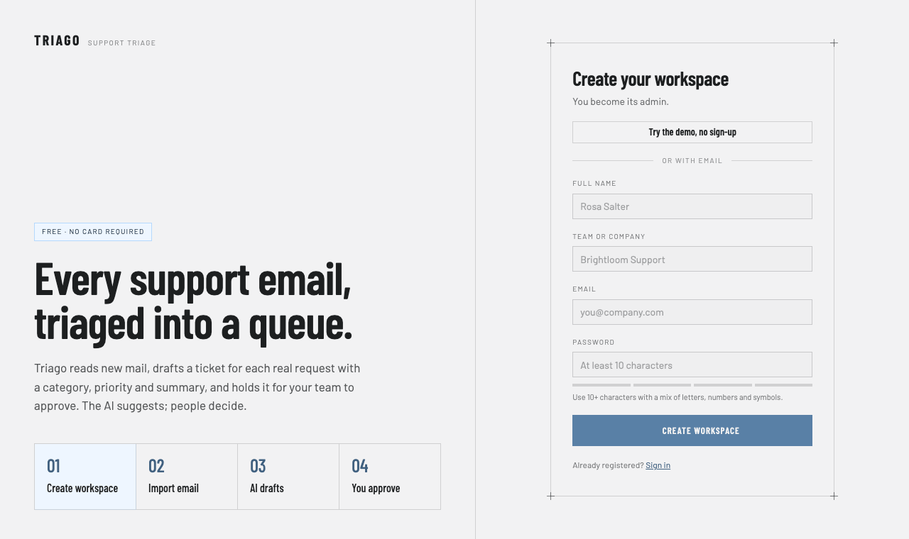
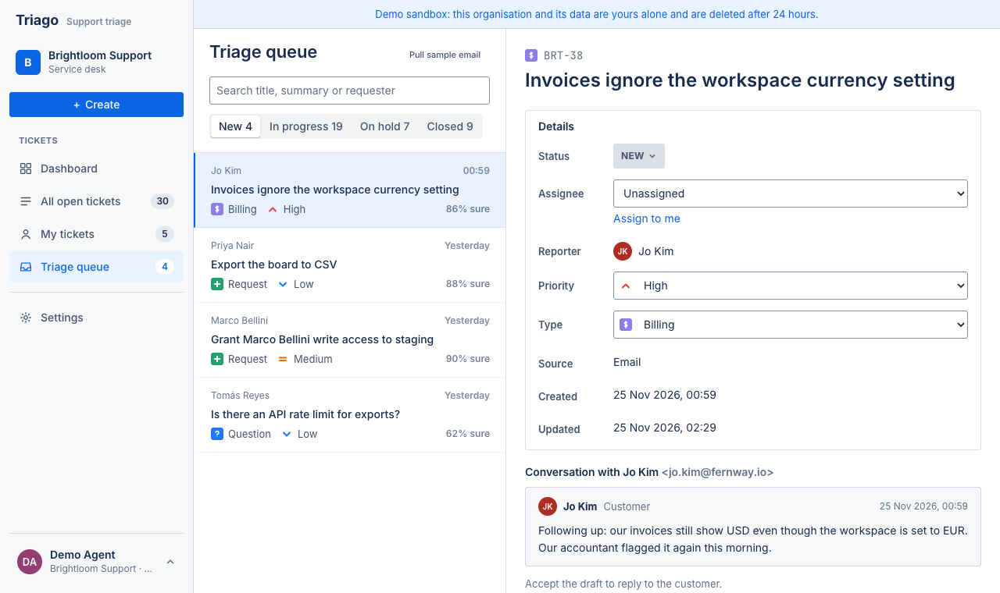
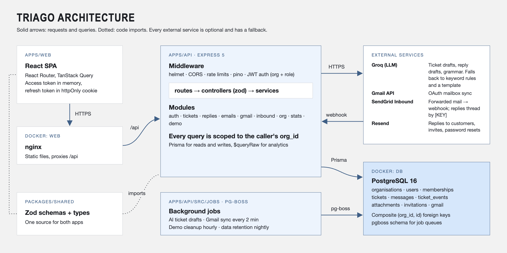

# Triago

[](https://github.com/chlosaw/Triago/actions/workflows/ci.yml)

A full-stack help desk that turns support emails into tickets. An AI model drafts each ticket with a title, summary, category and priority, and an agent reviews and accepts it.

**Live:** [triago.bid](https://triago.bid), click **Try the demo, no sign-up** to open a sandbox with sample tickets.





## Features

- **Email to ticket:** connect a Gmail mailbox ([docs/gmail.md](docs/gmail.md)) or forward mail to an inbound address ([docs/inbound-email.md](docs/inbound-email.md)). Each new email becomes a draft ticket.
- **AI drafts, people decide:** the AI suggests title, summary, category and priority; an agent accepts, edits or dismisses the draft.
- **Works without the AI:** keyword rules draft the ticket when the model is slow, down, or returns something unusable.
- **Tickets:** create, edit, assign, change status and priority, delete (admins only), attachments, links, internal notes and an activity log.
- **Search:** by title, summary and requester, plus filters by status and assignee.
- **Teams and roles:** admins and agents, email invitations, password reset; one person can belong to several organisations.
- **Dashboard:** your tickets and team statistics.
- **Demo sandbox:** every visitor gets a private, pre-filled organisation that is deleted after a day.
- Light and dark theme, responsive layout.

## Tech stack

| Layer    | Tools                                                      |
| -------- | ---------------------------------------------------------- |
| Frontend | React 18, TypeScript, Vite, React Router, TanStack Query   |
| Backend  | Node.js, Express 5, Zod, pino, pg-boss (background jobs)   |
| Database | PostgreSQL 16, Prisma                                      |
| AI       | Groq API (Llama 3.3), JSON output validated with Zod       |
| Infra    | Docker Compose, nginx, GitHub Actions                      |
| Tests    | Vitest, Testing Library, Supertest against a real Postgres |

## Architecture



- **`apps/web`** is a React single-page app. The access token lives in memory; the refresh token is in an httpOnly cookie.
- **nginx** serves the built frontend and proxies `/api` to the backend.
- **`apps/api`** is an Express app organised by module (`auth`, `tickets`, `emails`, `gmail`, `inbound`, `org`, `stats`, `demo`). Each request goes route → controller (Zod validation) → service.
- **PostgreSQL** stores everything, including the job queue. Every query is scoped to the caller's organisation, and child rows use composite `(org_id, id)` foreign keys so the database itself rejects cross-organisation links.
- **Background jobs** (pg-boss) sync mailboxes, draft tickets with the AI, and delete expired demo sandboxes, with retries and backoff.
- **`packages/shared`** holds the Zod schemas and TypeScript types that both apps import.

### Email-to-ticket flow

1. A new email arrives through Gmail sync or the inbound webhook.
2. The email is de-duplicated by its `Message-ID`, so the same email never becomes two tickets.
3. A ticket is created immediately with keyword-rule values, marked as "drafting".
4. A job sends a trimmed copy of the email (no quoted history, signature or footer) to the AI model.
5. If the model returns a valid draft, the ticket is updated. If it times out, errors or returns invalid JSON, the ticket keeps the keyword values and is flagged `ai_failed` for manual triage.
6. An agent reviews the draft in the queue and accepts or dismisses it.

## Key decisions

- **Keyword rules as a fallback.** The AI is an outside service that can be slow, rate-limited or wrong. The ticket is saved before the AI is called, and simple keyword rules fill in category and priority, so an email is never lost and the app never waits on the model. Failures are flagged so a person checks those tickets.
- **The AI drafts, an agent accepts.** Priority and category decide who sees a ticket and how fast. A wrong guess that went straight into the queue could bury an urgent customer. Keeping a person in the loop makes the AI a time-saver rather than a risk, and the model's confidence is shown to help the agent decide.
- **A separate sandbox per demo visitor.** A shared demo account gets messy and lets one visitor see or break what another did. Each "Try the demo" click creates a private organisation with sample tickets, and an hourly job deletes sandboxes older than a day.
- **One shared types package.** Request and response shapes are defined once as Zod schemas in `packages/shared`. The API uses them to validate input and the frontend uses the same types, so a change to the API that breaks the frontend fails the type check instead of failing in production.
- **Postgres for the job queue.** pg-boss keeps jobs in the same database, so there is no Redis to run and scheduled jobs survive restarts.

## Running locally

Requires Docker.

```bash
git clone https://github.com/chlosaw/Triago.git
cd Triago
cp .env.example .env    # set JWT_SECRET; GROQ_API_KEY is optional
docker compose up --build
```

Open http://localhost:8080 and click **Try the demo, no sign-up**.

- Get a free AI key at [console.groq.com/keys](https://console.groq.com/keys) and set `GROQ_API_KEY`. Without it, keyword rules draft every ticket.
- To import real mail, set `GOOGLE_CLIENT_ID` and `GOOGLE_CLIENT_SECRET` (see [docs/gmail.md](docs/gmail.md)).

### Without Docker for the app

```bash
docker compose up -d db   # Postgres on localhost:5432
npm install
npm run db:migrate
npm run dev
```

## Tests

```bash
docker compose up -d db
npm test
```

The API tests run against a real Postgres database (`triago_test`). They cover the email-to-ticket flow end to end (parsing, de-duplication, AI drafting and its fallback when the model fails or returns invalid output), Gmail sync, the inbound webhook, auth and password reset, roles and team management, and organisation isolation. The frontend has component and unit tests.

CI runs lint, format check, type check, tests, the production build, a dependency audit and the Docker build on every push.

## Scripts

- `npm run dev`: start the API and web app in development mode
- `npm run build`: build for production
- `npm test`: run all tests
- `npm run lint` / `npm run typecheck` / `npm run format:check`
